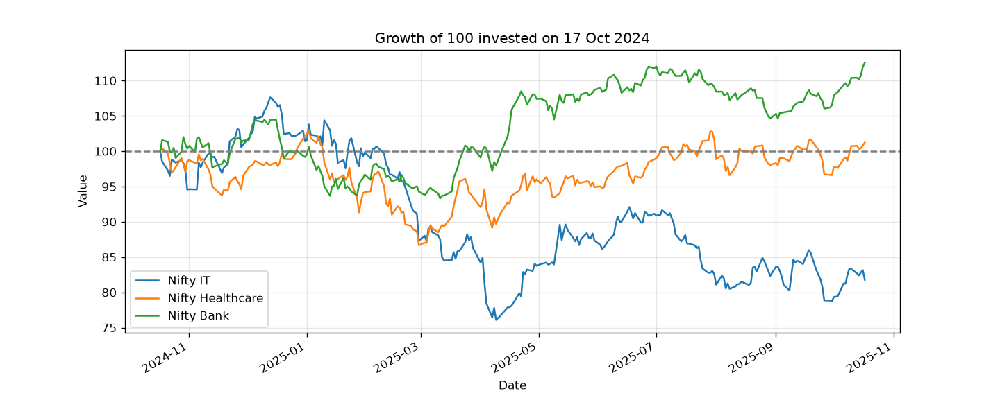
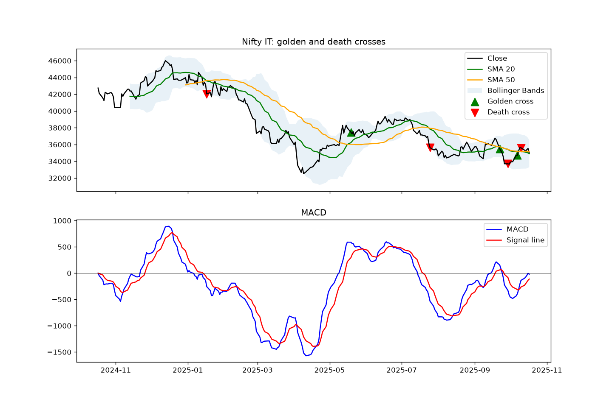
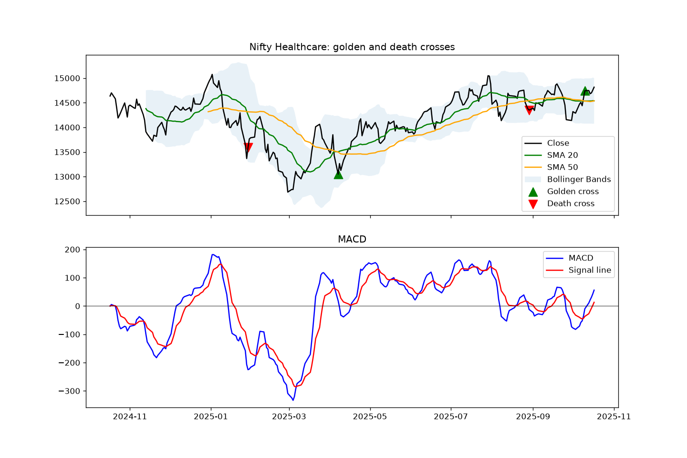
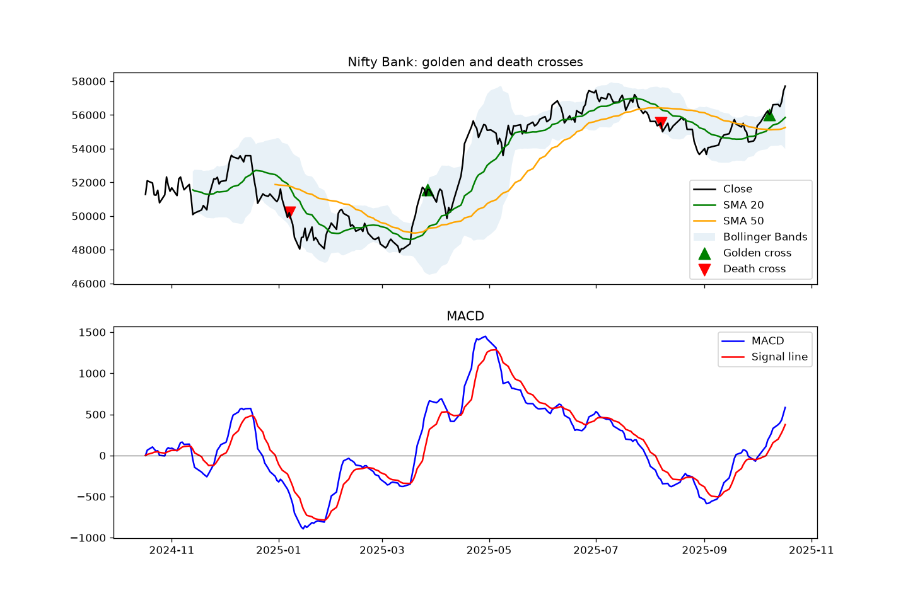

# 📈 Technical Analysis Using MACD, Bollinger Bands, and Moving Averages
### A Sectorial Study with Special Reference to IT and Healthcare Sector

**Moving averages, MACD and Bollinger Bands applied to Nifty IT, Nifty Healthcare and Nifty Bank (Python)**

This project finds every **golden cross** and **death cross** in three Indian sector indices over one year. It checks what the price did after each signal, and tests whether trading the crosses beat simply buying and holding the index.



## 🎯 Objectives
1. Identify golden crosses (buy) and death crosses (sell) using the 20-day and 50-day moving averages.
2. Check whether each signal was followed by a move in the expected direction.
3. Test a golden-cross trading strategy against buy & hold.
4. Compare how a cyclical export sector (IT), a defensive sector (Healthcare) and a rate-sensitive sector (Banking) behaved.

## 📁 Data
| Index | Sector | Source |
|---|---|---|
| Nifty IT | Information Technology (export-driven) | Yahoo Finance (`^CNXIT`) |
| Nifty Healthcare | Healthcare (defensive) | NSE data from my MBA dissertation workbook |
| Nifty Bank | Banking (interest-rate sensitive) | Yahoo Finance (`^NSEBANK`) |

**Period:** 17 Oct 2024 – 17 Oct 2025, daily closing prices. Data cleaning (`src/download_data.py`):
- sorted oldest to newest
- removed duplicate dates and zero prices
- filled single missing days with the previous close
- flagged daily moves above 10% for checking

## 🛠️ Method
| Tool | Settings | Signal |
|---|---|---|
| Moving averages | SMA 20 and SMA 50 | **Golden cross:** SMA 20 crosses above SMA 50 (buy). **Death cross:** SMA 20 crosses below SMA 50 (sell). |
| MACD | 12, 26, 9 | Confirms momentum (shown on each chart) |
| Bollinger Bands | 20 days, ±2 standard deviations | Shows volatility (shaded on each chart) |

- **Signal check:** the price move over the 20 trading days after each cross.
- **Strategy:** buy at each golden cross, sell at the next death cross, and value any open trade at the last price. It is compared with buy & hold over the same period, from day 50 onwards. Trading costs are not included.

## 📊 Results

### Returns and risk
| Index | Total return | Volatility (yearly) | Max drawdown |
|---|---|---|---|
| Nifty Bank | **+12.53%** | 13.97% | −10.73% |
| Nifty Healthcare | **+1.23%** | 16.09% | −15.85% |
| Nifty IT | **−18.21%** | 22.03% | −29.30% |

### Golden and death crosses
| Index | Date | Signal | Price | Move over next 20 days |
|---|---|---|---|---|
| Nifty IT | 17 Jan 2025 | Death cross (sell) | 42,032.20 | −1.72% ✅ |
| Nifty IT | 19 May 2025 | Golden cross (buy) | 37,477.80 | +4.26% ✅ |
| Nifty IT | 25 Jul 2025 | Death cross (sell) | 35,623.75 | +1.84% ❌ |
| Nifty IT | 22 Sep – 10 Oct 2025 | 2 golden + 2 death crosses | – | too recent |
| Nifty Healthcare | 29 Jan 2025 | Death cross (sell) | 13,588.55 | −4.54% ✅ |
| Nifty Healthcare | 7 Apr 2025 | Golden cross (buy) | 13,048.90 | +4.78% ✅ |
| Nifty Healthcare | 29 Aug 2025 | Death cross (sell) | 14,350.30 | −1.36% ✅ |
| Nifty Healthcare | 10 Oct 2025 | Golden cross (buy) | 14,742.25 | too recent |
| Nifty Bank | 7 Jan 2025 | Death cross (sell) | 50,202.15 | −0.09% ✅ |
| Nifty Bank | 27 Mar 2025 | Golden cross (buy) | 51,575.85 | +6.81% ✅ |
| Nifty Bank | 7 Aug 2025 | Death cross (sell) | 55,521.15 | −2.40% ✅ |
| Nifty Bank | 8 Oct 2025 | Golden cross (buy) | 56,018.25 | too recent |

**8 of the 9 crosses that could be checked moved in the expected direction within 20 trading days.**

| Nifty IT | Nifty Healthcare | Nifty Bank |
|---|---|---|
|  |  |  |

### Golden-cross strategy vs buy & hold
| Index | Trades | Strategy return | Buy & hold | Result |
|---|---|---|---|---|
| Nifty Healthcare | 2 | **+10.52%** | −0.53% | Strategy better by 11.1 points |
| Nifty IT | 3 | **−7.45%** | −20.52% | Strategy lost 13.1 points less |
| Nifty Bank | 2 | +10.91% | **+13.27%** | Buy & hold better by 2.4 points |

Best single trade: **Nifty Healthcare, bought 7 Apr 2025 and sold 29 Aug 2025, +9.97%.**
### MACD and Bollinger Band signals
How often each signal was followed by a move in the right direction within 20 trading days (number of signals in brackets):

| Signal | Nifty IT | Nifty Healthcare | Nifty Bank |
|---|---|---|---|
| MACD bullish cross (buy) | 33.3% (7) | 60.0% (11) | 57.1% (8) |
| MACD bearish cross (sell) | 50.0% (7) | 50.0% (11) | 28.6% (8) |
| Close below lower band (buy) | 42.9% (8) | 50.0% (5) | 33.3% (6) |
| Close above upper band (sell) | **100.0% (5)** | 60.0% (5) | 40.0% (7) |

## 💡 Key findings
1. **The three sectors moved very differently.** Banking rose 12.5% with the lowest volatility. Healthcare was flat (+1.2%). IT fell 18.2% and suffered the deepest fall (−29.3%).
2. **The crosses caught the major trends.** The death cross in IT on 17 Jan 2025 came before a slide to the April low, and the golden crosses in Healthcare (7 Apr) and Bank (27 Mar) marked the start of their recoveries. 8 of 9 checkable signals pointed the right way.
3. **The strategy beat buy & hold in 2 of 3 sectors.** It turned a flat Healthcare year into +10.5% by being invested only during the April–August uptrend. In IT it cut the loss from −20.5% to −7.5% by staying out of most of the fall.
4. **It lagged in a steady uptrend.** In Nifty Bank the strategy earned 10.9% vs 13.3% for buy & hold. Moving averages confirm a trend only after it has started, so the strategy entered late and exited early.
5. **Sideways markets cause whipsaws.** IT produced four crosses in four weeks (22 Sep – 10 Oct 2025) as the price moved sideways, and two of its three trades lost money.
6. **MACD on its own was close to a coin toss.** Its crossovers were right 29–60% of the time. Buy signals failed most in falling IT (33%), and sell signals failed most in rising Bank (29%). MACD works best as confirmation of the moving-average trend, not as a stand-alone signal.
7. **Bollinger Bands worked with the trend, not against it.** "Below the lower band" buy signals were weak everywhere (33–50%), because a falling price often kept falling. But in downtrending IT, every "above the upper band" sell signal was followed by a fall (100%, 5 of 5). Bollinger Bands are most useful for spotting short-term extremes in the direction of the main trend.

## ✅ Conclusion
Moving averages were the most reliable of the three tools: golden and death crosses identified the major trend changes in all three sectors, 8 of 9 checkable crosses moved in the expected direction, and the golden-cross strategy beat buy & hold in IT and Healthcare by avoiding large falls. MACD on its own gave frequent, unreliable signals and works best as confirmation of the moving-average trend. Bollinger Bands were most useful for spotting short-term extremes in the direction of the main trend, not for buying dips in a falling market. Overall, combining a trend tool (moving averages) with momentum (MACD) and volatility (Bollinger Bands) gives better decisions than any single indicator, and technical analysis is most valuable as a **risk-control tool** read in the context of each sector's behaviour.

Golden and death crosses identified the major trend changes in all three sectors, and most signals were followed by a move in the expected direction. Their main value was **risk control**: avoiding the large fall in IT and the weak phase in Healthcare. Their weakness is **lag**, which cost some return in Nifty Bank's steady rise, and **whipsaws** in sideways markets. The crosses work best as a trend filter combined with MACD for momentum confirmation, and should be read in the context of each sector's behaviour.

**Limitations:** one year of data and few trades per index; no brokerage, taxes or slippage; price indices exclude dividends; results may not repeat in other periods.

## 🗂️ Project structure
```
├── data/
│   ├── raw_prices.csv          # downloaded data, untouched
│   ├── clean_prices.csv        # cleaned data used in the analysis
│   └── nifty_healthcare.csv    # Nifty Healthcare source data
├── src/
│   ├── download_data.py        # downloads and cleans the data
│   └── analysis.py             # returns, crosses, charts, strategy test
├── outputs/
│   ├── summary.csv, crosses.csv, results.xlsx
│   └── charts (*.png)
└── requirements.txt
```

## ▶️ How to run
```bash
pip install -r requirements.txt
python src/download_data.py
python src/analysis.py
```

## 🧰 Tools
Python · pandas · NumPy · Matplotlib · yfinance

---
👤 **Shanmukha Badiger**, MBA, M P Birla Institute of Management
